# Powered by Happy Hearts

## Installing or updating Happy Hearts — step by step (with pictures)
## نصب یا به‌روزرسانی Happy Hearts — قدم‌به‌قدم (با تصویر)

### English

Your servers and settings are kept when you update. Android shows a few red warnings for **every app installed outside an app store**. They do not mean something is wrong, and it only takes a minute. Pick your phone:

- **Samsung and most phones (Android 14–16)** — go to Part A.
- **Xiaomi / Redmi / POCO (MIUI, HyperOS)** — go to Part B.

The pictures are from a Samsung A16 (Android 16) and a Xiaomi phone (Android 13). Your screens may look a little different, but the steps are the same.

#### Part A — Samsung and most phones

**1. Open the file.** Open the downloaded `HappyHearts.apk` (from Files or Downloads) and tap it. If you update from inside the app, tap **Update** instead.

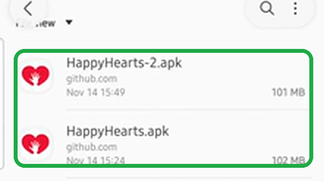

**2. Allow installs (first time only).** If Android shows **Install unknown apps**, turn **Allow permission** on, then go back.

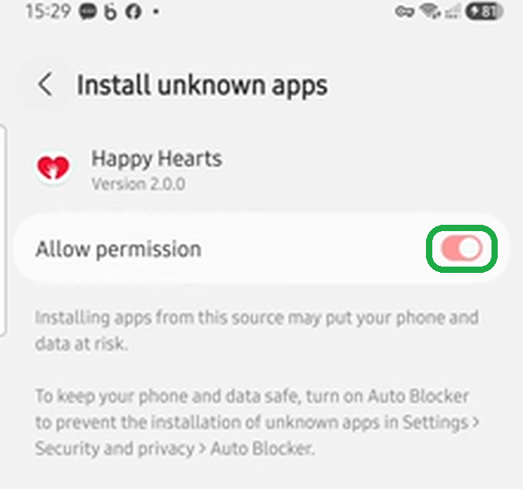

**3. “Harmful app blocked”.** Google Play Protect shows this red message for apps that are not from Google Play. Do **not** tap the big blue **Got it** button — it cancels the install. If you do not see “Install anyway”, tap **More details**. Then tap the small text **Install anyway**.

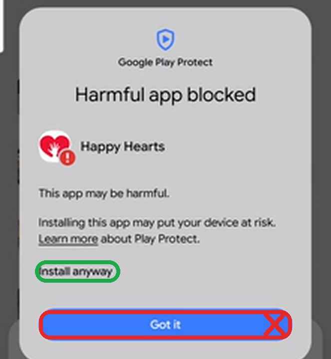

**4. Enter your PIN.** Your phone may ask for your PIN or fingerprint. The screen can turn black for a moment. This is normal. Enter it and wait a few seconds.

**5. Open.** When you see **App installed**, tap **Open**.

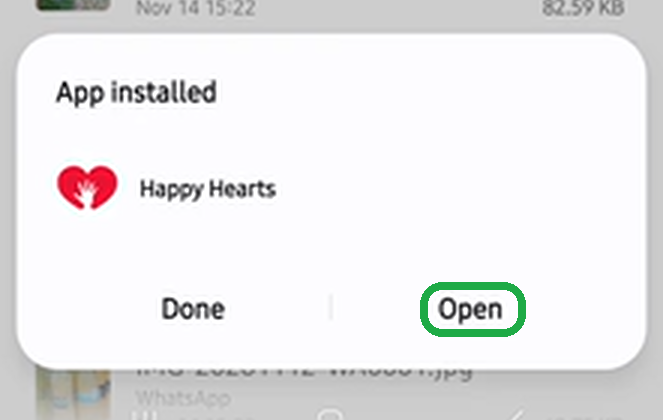

#### Part B — Xiaomi / Redmi / POCO

**1. Allow the app to install updates (first time only).** Tap **Update** in the app. If asked, turn on **Allow from this source**, then go back.

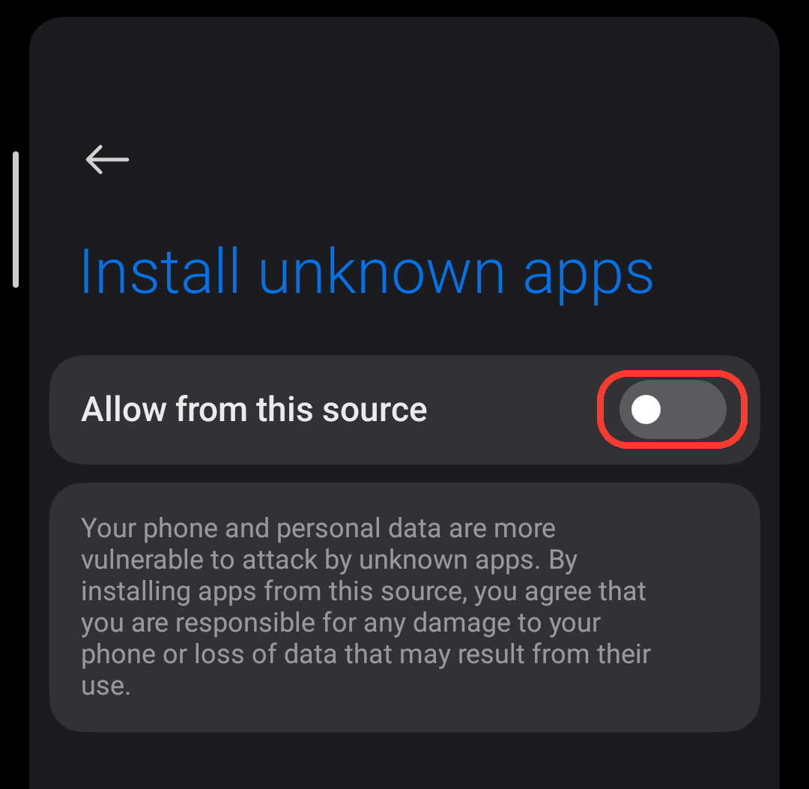

**2. A red “Danger” screen may appear.** This is Xiaomi’s standard text for any app outside a store. Tick **“I’m aware of the possible risks…”**, wait for the countdown, then tap **OK**.

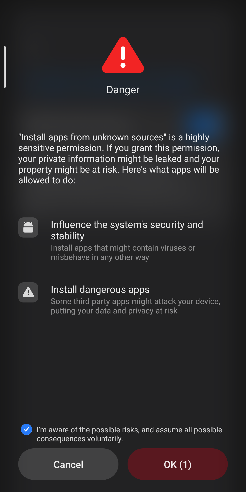

**3. If you are asked “Open with”,** choose **Package installer**.

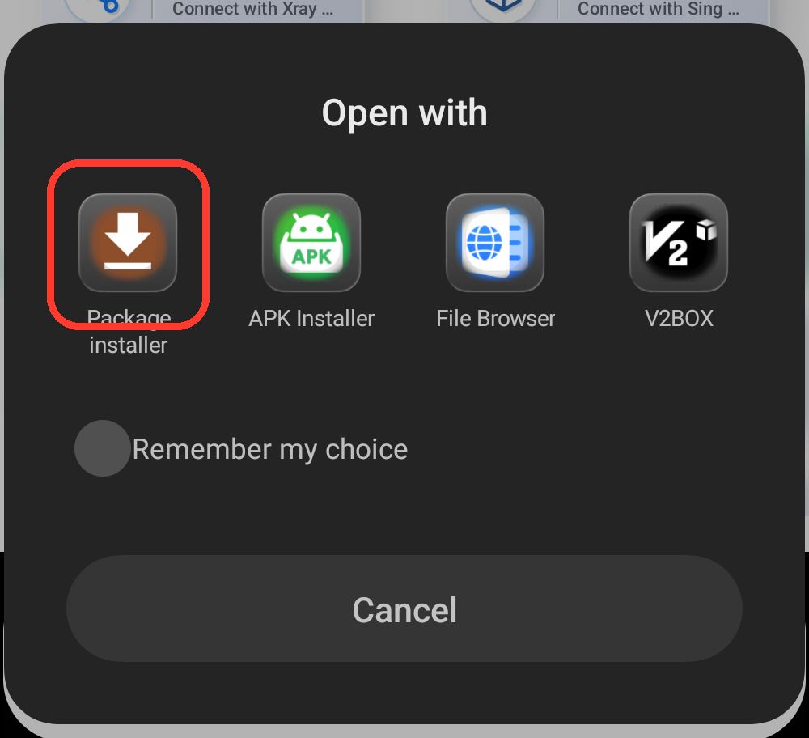

**4. Tap “Update”** (or **Install** on a first install).

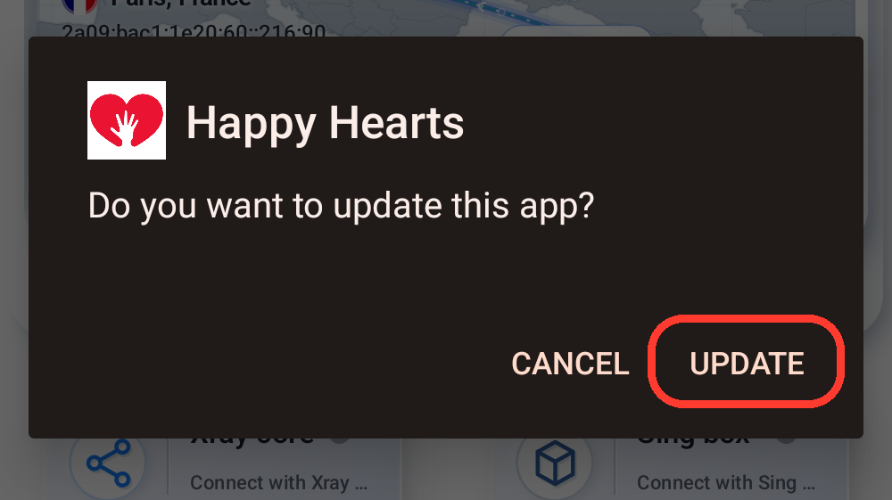

**5. Google Play Protect may say “App scan recommended”.** It only means Google has not seen this file yet. Tap **Install without scanning**, or tap **Scan app** and wait.

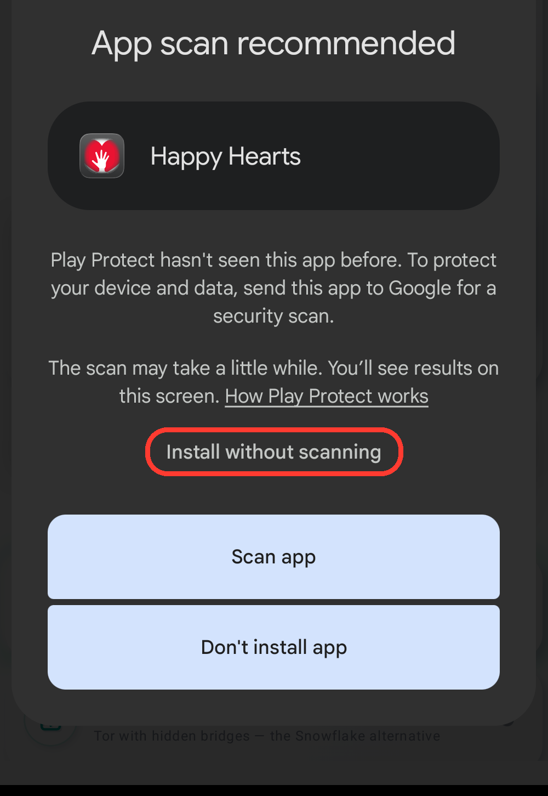

**6. If it then says “Harmful app blocked”,** do **not** press **OK** (OK cancels). Tap **More details**.

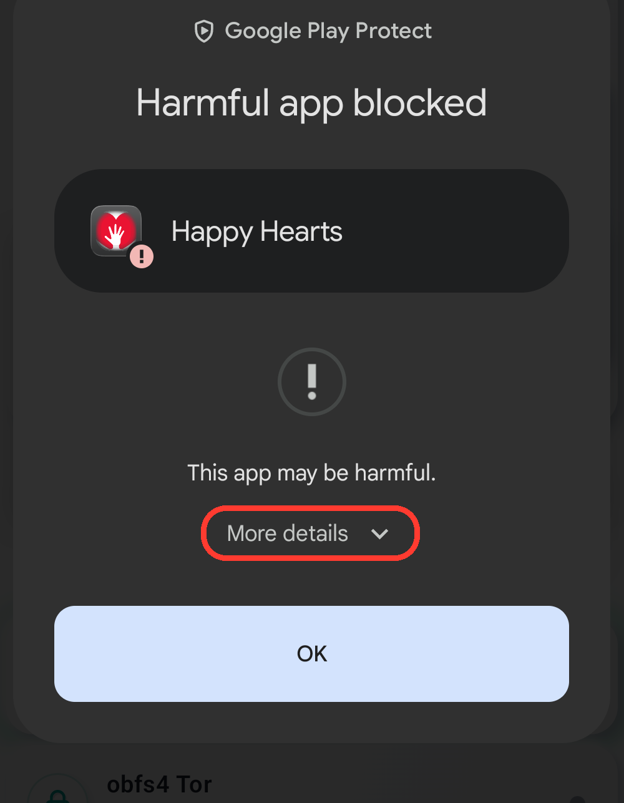

**7. Tap “Install anyway”.**

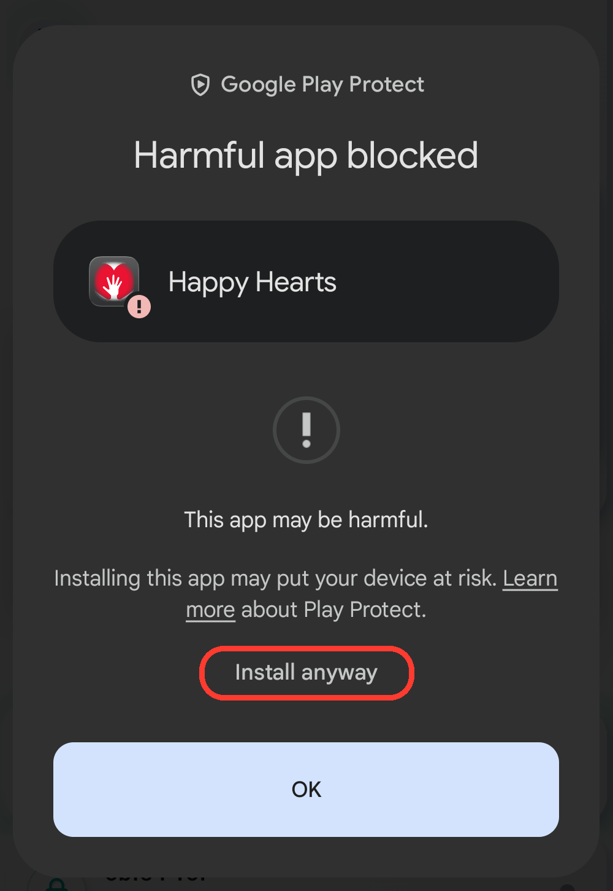

**8. Enter your PIN if asked.** The screen may turn black for a moment. Xiaomi then runs its own scan. When it finishes, tap **Open**.

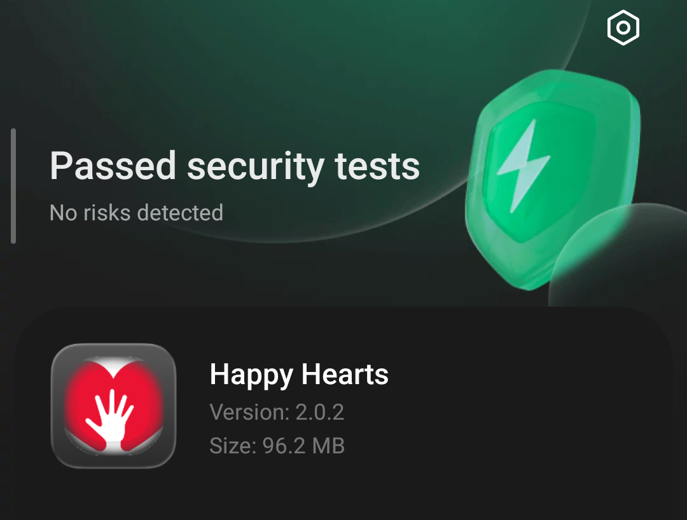

**Why does Play Protect warn?** Google Play Protect checks every app installed outside Google Play and sometimes warns about new or little-known apps. Xiaomi’s own scan found no risks in our tests. This is not a guarantee, but it is a good sign. Every release of this free app is signed with the same key, and you can verify the file yourself: compare the SHA-256 of `HappyHearts.apk` with the value on the release page.

**There is no “Install anyway” button?** Then your phone blocked this install completely. Try again later or download the file again from the release page.

### فارسی

سرورها و تنظیمات شما در به‌روزرسانی حفظ می‌شود. اندروید برای **هر برنامه‌ای که بیرون از فروشگاه نصب شود** چند هشدار قرمز نشان می‌دهد. این هشدارها یعنی مشکلی پیش نیامده و فقط یک دقیقه طول می‌کشد. گوشی خود را انتخاب کنید:

- **سامسونگ و بیشتر گوشی‌ها (اندروید ۱۴ تا ۱۶)** — بخش الف.
- **شیائومی / ردمی / پوکو** — بخش ب.

تصاویر از سامسونگ A16 (اندروید ۱۶) و یک گوشی شیائومی (اندروید ۱۳) است. صفحه‌های گوشی شما ممکن است کمی فرق داشته باشد، ولی مراحل همان است.

#### بخش الف — سامسونگ و بیشتر گوشی‌ها

**۱. فایل را باز کنید.** فایل دانلودشدهٔ `HappyHearts.apk` را (از Files یا Downloads) باز کنید و روی آن بزنید. اگر از داخل برنامه به‌روزرسانی می‌کنید، **Update** را بزنید.

**۲. اجازهٔ نصب (فقط بار اول).** اگر **Install unknown apps** آمد، **Allow permission** را روشن کنید و برگردید.

**۳. «Harmful app blocked».** Google Play Protect این پیام قرمز را برای برنامه‌هایی که از گوگل‌پلی نیستند نشان می‌دهد. دکمهٔ آبی بزرگ **Got it** را **نزنید**؛ نصب را لغو می‌کند. اگر «Install anyway» را نمی‌بینید، روی **More details** بزنید. بعد روی متن ریز **Install anyway** بزنید.

**۴. پین را وارد کنید.** ممکن است گوشی پین یا اثر انگشت بخواهد. صفحه می‌تواند لحظه‌ای سیاه شود؛ عادی است. وارد کنید و چند ثانیه صبر کنید.

**۵. باز کردن.** وقتی **App installed** آمد، **Open** را بزنید.

#### بخش ب — شیائومی / ردمی / پوکو

**۱. اجازهٔ نصب به‌روزرسانی (فقط بار اول).** در برنامه **Update** را بزنید. اگر خواست، **Allow from this source** را روشن کنید و برگردید.

**۲. ممکن است صفحهٔ قرمز «Danger» بیاید.** این متن استاندارد شیائومی برای هر برنامهٔ بیرون از فروشگاه است. تیک **«I’m aware of the possible risks…»** را بزنید، تا پایان شمارش صبر کنید و **OK** را بزنید.

**۳. اگر پرسید «Open with»،** گزینهٔ **Package installer** را انتخاب کنید.

**۴. روی «Update» بزنید** (در نصب اول **Install**).

**۵. ممکن است Google Play Protect بنویسد «App scan recommended».** فقط یعنی گوگل هنوز این فایل را ندیده است. روی **Install without scanning** بزنید، یا **Scan app** را بزنید و صبر کنید.

**۶. اگر بعدش نوشت «Harmful app blocked»،** دکمهٔ **OK** را **نزنید** (OK نصب را لغو می‌کند). روی **More details** بزنید.

**۷. روی «Install anyway» بزنید.**

**۸. اگر پین خواست، وارد کنید.** صفحه ممکن است لحظه‌ای سیاه شود. بعد شیائومی اسکن خودش را انجام می‌دهد و پس از پایان، **Open** را بزنید.

**چرا Play Protect هشدار می‌دهد؟** Google Play Protect هر برنامه‌ای را که از گوگل‌پلی نصب نشده بررسی می‌کند و گاهی برای برنامه‌های تازه یا کم‌شناخته هشدار می‌دهد. اسکن خود شیائومی در آزمایش‌های ما خطری پیدا نکرد. این تضمین نیست، ولی نشانهٔ خوبی است. همهٔ نسخه‌های این برنامهٔ رایگان با یک کلید امضا می‌شوند و خودتان هم می‌توانید فایل را بررسی کنید: SHA-256 فایل `HappyHearts.apk` را با مقدار صفحهٔ ریلیز مقایسه کنید.

**دکمهٔ «Install anyway» نیست؟** یعنی گوشی این نصب را کامل بلاک کرده است. کمی بعد دوباره امتحان کنید یا فایل را دوباره از صفحهٔ ریلیز دانلود کنید.
