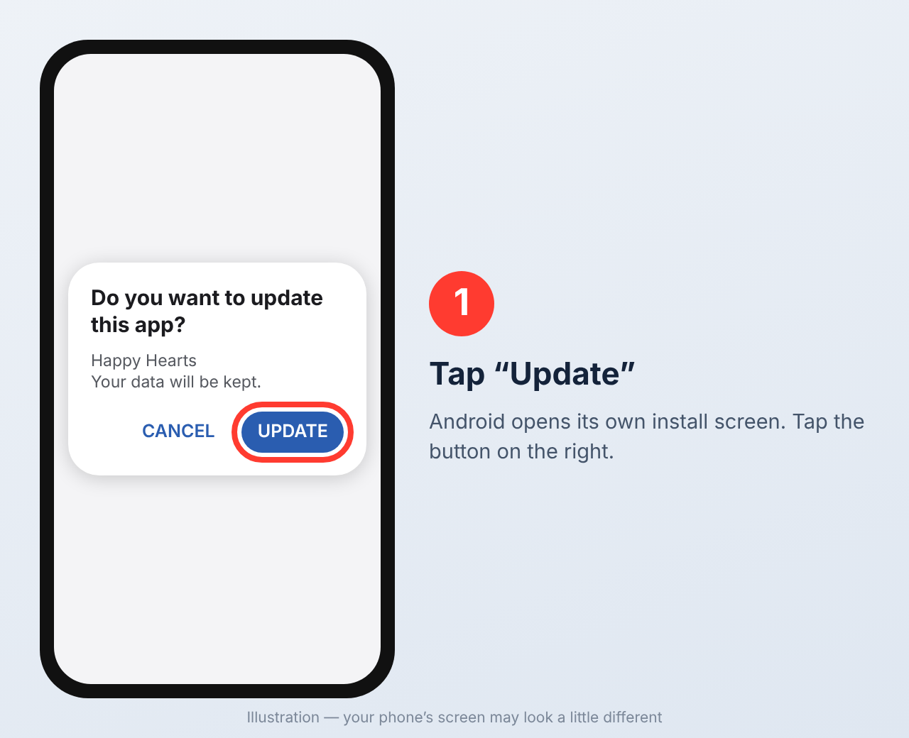
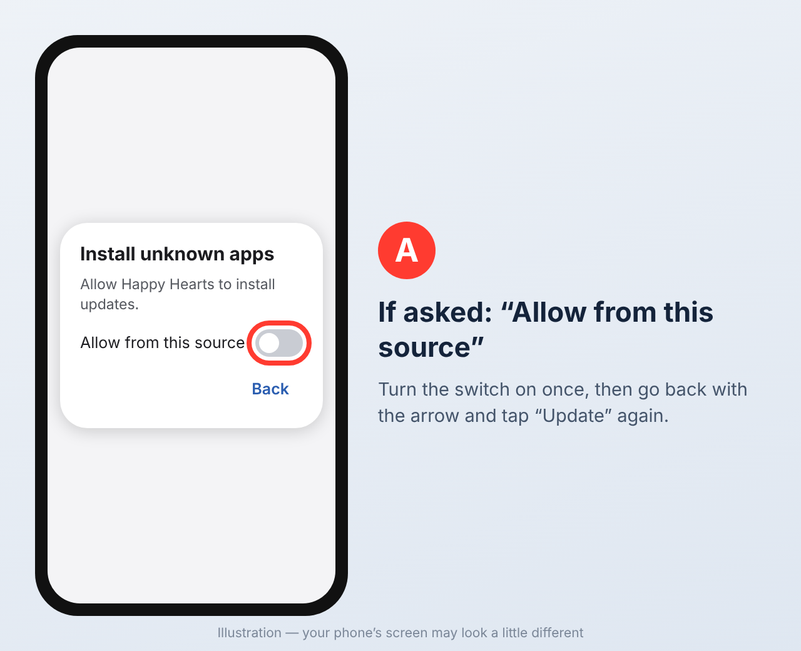
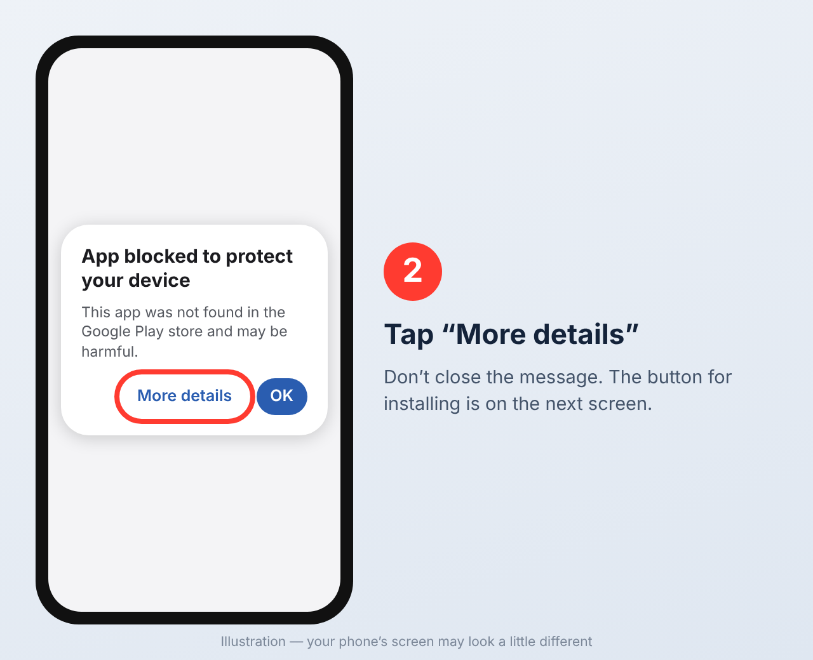
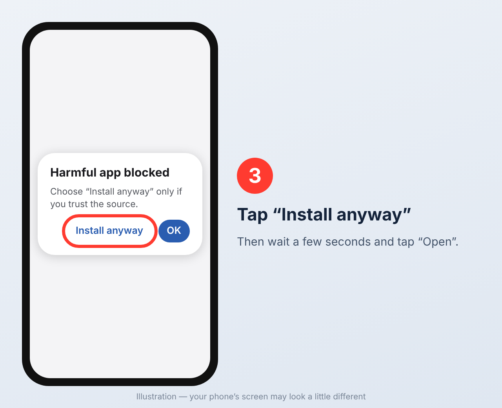

# Powered by Happy Hearts

## Installing an update — what to do if your phone shows a message
## نصب به‌روزرسانی — اگر گوشی پیامی نشان داد چه کنید

### English

Your servers and settings are kept. Updating never erases them.
Phones from different brands (Samsung, Xiaomi, Pixel…) and Android versions word these screens a little differently, but the idea is always the same.

**1. Tap “Update”.** In the app tap **Update**. Android opens its own install screen. Tap **Update** there too.

**A. If your phone says “Install unknown apps” / “For your security, your phone isn’t allowed to install unknown apps from this source”:** tap **Settings**, turn on **Allow from this source**, press back, and tap **Update** again. You do this only once.

**2. If a warning says “App blocked to protect your device” or “Harmful app blocked”:** don’t close it. Tap **More details**.

**3. Tap “Install anyway”.** Wait a few seconds, then tap **Open**. Done.

**Why does this appear?** Google Play Protect checks apps that were not installed from Google Play, and it sometimes shows this warning for new or little-known apps. Every release of this free app is signed with the same key.

**There is no “Install anyway” button?** Then your phone has fully blocked this install. Try again later, or download the file again from this page. As a last resort, and only if you trust the source, you can pause “Scan apps with Play Protect” in Play Store → profile picture → Play Protect → settings, install the update, and **turn scanning back on right after**.

**Want to check the file yourself?** Compare the SHA-256 of the downloaded `HappyHearts.apk` with the value in `HappyHearts.apk.sha256` on the release page.

### فارسی

سرورها و تنظیمات شما حفظ می‌شود؛ به‌روزرسانی چیزی را پاک نمی‌کند.
گوشی‌های برندهای مختلف (سامسونگ، شیائومی، پیکسل…) و نسخه‌های اندروید این صفحه‌ها را کمی متفاوت می‌نویسند، ولی کار همیشه یکی است.

**۱. «Update» را بزنید.** در برنامه روی **Update** (به‌روزرسانی) بزنید. صفحهٔ نصبِ خود اندروید باز می‌شود؛ آنجا هم **Update** را بزنید.

**الف. اگر گوشی نوشت «Install unknown apps» یا «برای امنیت شما، گوشی اجازهٔ نصب برنامهٔ ناشناخته از این منبع را نمی‌دهد»:** روی **Settings** بزنید، گزینهٔ **Allow from this source** (اجازه از این منبع) را روشن کنید، با فلش برگردید و دوباره **Update** را بزنید. این کار فقط یک‌بار لازم است.

**۲. اگر هشدار «App blocked to protect your device» یا «Harmful app blocked» آمد:** آن را نبندید. روی **More details** (جزئیات بیشتر) بزنید.

**۳. روی «Install anyway» (نصب به هر حال) بزنید.** چند ثانیه صبر کنید و **Open** (باز کردن) را بزنید. تمام.

**چرا این پیام می‌آید؟** سرویس Google Play Protect برنامه‌هایی را که از گوگل‌پلی نصب نشده‌اند بررسی می‌کند و گاهی برای برنامه‌های تازه یا کم‌شناخته هم این هشدار را نشان می‌دهد. همهٔ نسخه‌های این برنامهٔ رایگان با یک کلید امضا می‌شوند.

**دکمهٔ «Install anyway» نیست؟** یعنی گوشی این نصب را کامل بلاک کرده است. کمی بعد دوباره امتحان کنید یا فایل را از همین صفحه دوباره دانلود کنید. به‌عنوان آخرین راه، و فقط اگر به منبع اعتماد دارید، می‌توانید در Play Store ← عکس پروفایل ← Play Protect ← تنظیمات، گزینهٔ «Scan apps with Play Protect» را موقتاً متوقف کنید، به‌روزرسانی را نصب کنید و **بلافاصله دوباره روشنش کنید**.

**می‌خواهید خودتان فایل را بررسی کنید؟** مقدار SHA-256 فایل دانلودشدهٔ `HappyHearts.apk` را با مقدار داخل `HappyHearts.apk.sha256` در صفحهٔ ریلیز مقایسه کنید.
